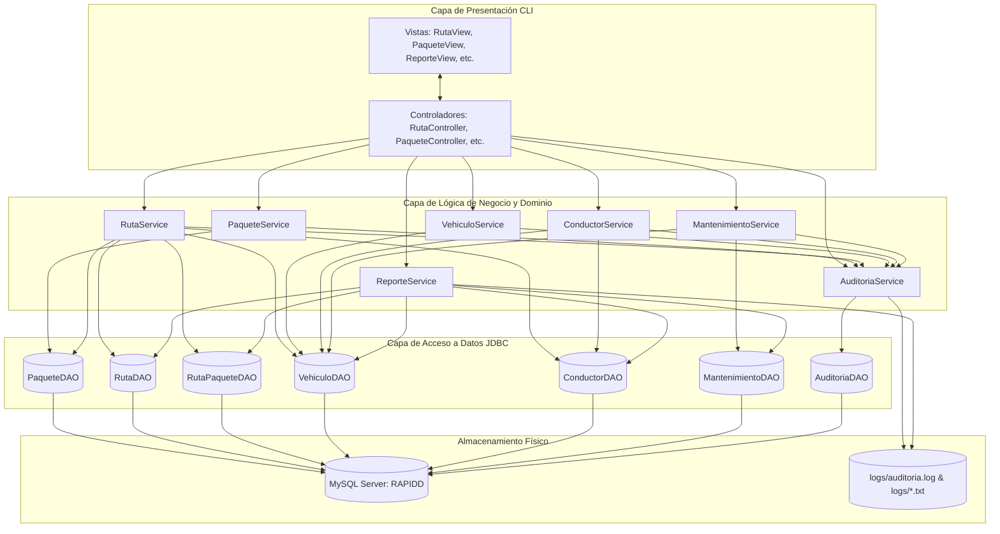

# Documentación Técnica de Reestructuración Arquitectónica y Principios SOLID
**Proyecto:** RapidExpress - Sistema de Gestión de Flotas y Rutas  
**Fecha:** 2026-09-03  
**Estado:** ✅ Remediación y Estructuración Completa  
**Auditoría y Ejecución:** Desarrollador Senior Java / Ingeniero de Software  

---

## 1. Resumen Ejecutivo

A partir del diagnóstico formal emitido en `FALLOS_Y_PRINCIPIOS_SOLID.md`, se identificó que el sistema RapidExpress contaba con un modelo de datos relacional robusto y servicios de negocio bien diseñados, pero sufría de una **desconexión arquitectónica severa**: la capa de controladores de terminal (`com.RapidExpress.controller.*`) consumía de forma directa los objetos de acceso a datos (`com.RapidExpress.dao.*`), dejando inerte la capa de servicios (`com.RapidExpress.service.*`).

Esta desconexión provocaba **5 fallos operativos críticos** que impedían el funcionamiento normal de la logística empresarial y constituía una violación generalizada a los **Principios SOLID** (particularmente SRP, DIP, LSP y OCP).

La intervención realizada reestructuró la arquitectura conectando integralmente las capas existentes, resolviendo los 5 fallos operativos, implementando los principios SOLID mediante inyección de dependencias por constructor y estandarización de excepciones, incorporando pruebas unitarias automatizadas con JUnit 5 (100% exitosas) y manteniendo intacta la base de datos y la organización del proyecto.

---

## 2. Resolución Detallada de los 5 Fallos Críticos

### Fallo 1: Creación de Paquetes Rota por Envío de Clave Primaria Nula
- **Problema previo:** `PaqueteView.readNewPaqueteData()` retornaba un objeto `Paquete` con `idSeguimiento = null`. Como `PaqueteController` llamaba directamente a `PaqueteDAO.create()`, se ejecutaba un `INSERT` con valor `null` en la columna `id_seguimiento` (`VARCHAR(36) NOT NULL PRIMARY KEY`), provocando una `SQLException` y bloqueando el registro de envíos.
- **Solución implementada:**
  1. En `PaqueteService.registrarPaquete()`, se incorporó la validación preventiva de nulidad de la entidad y la autogeneración de identificadores únicos con prefijo estándar (`PKG-` + UUID de 8 caracteres alfanuméricos en mayúsculas).
  2. Se modificó `PaqueteController.crearPaquete()` para delegar la creación exclusivamente en `paqueteService.registrarPaquete(paquete, "OPERADOR_CLI")`.
  3. El identificador asignado se notifica de inmediato al operador en consola.
  4. La operación se registra automáticamente en la bitácora dual de auditoría.

---

### Fallo 2: Planificación de Rutas sin Asignación de Carga ni Control de Capacidad
- **Problema previo:** El requisito oficial exige crear hojas de ruta asignando paquetes en bodega a un vehículo y conductor sin exceder la capacidad de carga en kg del automotor. `RutaController` creaba cabeceras de ruta sin solicitar paquetes al operador, dejando la tabla `ruta_paquete` vacía e ignorando la validación de peso y la excepción `CapacidadExcedidaException`.
- **Solución implementada:**
  1. Se implementó en `RutaView.readPaquetesSeleccionados()` una interfaz tabular que lista todos los paquetes disponibles en bodega (`paqueteService.listarEnBodega()`), permitiendo al operador ingresar los IDs a cargar (o usar la instrucción `TODOS`).
  2. En `RutaController.crearRuta()`, se captura la selección y se invoca a `rutaService.crearHojaDeRuta(fecha, vehiculoPlaca, conductorId, paquetesSeleccionados, "OPERADOR_CLI")`.
  3. El servicio calcula la sumatoria estricta del peso en kilogramos de los paquetes, verifica que el vehículo esté `Disponible` y el conductor `Activo`, y compara el peso acumulado contra `vehiculo.getCapacidadMaxKg()`.
  4. Si se supera el límite de carga, se lanza y captura `CapacidadExcedidaException`, mostrando en pantalla el peso solicitado versus la capacidad máxima permitida.
  5. Si es válido, se insertan los registros en `ruta_paquete` con su respectivo orden de entrega y se actualiza el estado de cada paquete a `Asignado_Ruta`.

---

### Fallo 3: Inicio de Ruta Incompleto (Inconsistencia de Estados)
- **Problema previo:** Al iniciar una ruta, el controlador original solo actualizaba la fila en la tabla `ruta` (`UPDATE ruta SET estado = 'En_Curso'`). El vehículo seguía figurando como `Disponible`, el conductor como `Activo`, y los paquetes seguían como `En_Bodega` o `Asignado_Ruta`.
- **Solución implementada:**
  1. En `RutaController.iniciarRuta()`, se delegó la acción a `rutaService.iniciarRuta(idRuta, "OPERADOR_CLI")`.
  2. El servicio ejecuta una orquestación atómica multi-entidad:
     - Ruta cambia a `En_Curso`.
     - Vehículo cambia a `En_Ruta`.
     - Conductor cambia a `En_Ruta`.
     - Todos los paquetes asociados en `ruta_paquete` y en la tabla `paquete` cambian coordinadamente a `En_Transito`.
  3. Se conectaron de igual forma `completarRuta` (liberando vehículo a `Disponible` y conductor a `Activo`) y `cancelarRuta` (restaurando vehículos, conductores y reingresando paquetes no entregados a `En_Bodega`).
  4. Se habilitaron las opciones `14. Ver paquetes de una ruta` y `15. Actualizar estado de entrega de paquete` (`Entregado`, `Devuelto`, `No_Entregado`), cumpliendo con el monitoreo en tiempo real solicitado en `Contexto.md`.

---

### Fallo 4: Desconexión Total del Sistema de Auditoría y Persistencia en Archivo Plano
- **Problema previo:** Ni `AuditoriaService` ni la utilidad `FileLogUtil.appendAuditLog()` eran invocados por ningún controlador, impidiendo registrar auditoría en la base de datos MySQL y en el archivo de texto plano `logs/auditoria.log`.
- **Solución implementada:**
  1. Al conectar todos los controladores (`PaqueteController`, `RutaController`, `VehiculoController`, `ConductorController`, `MantenimientoController`) a sus respectivos servicios, cada operación de creación, actualización, cambio de estado o eliminación dispara automáticamente `AuditoriaService.registrar(...)`.
  2. El servicio de auditoría garantiza la persistencia dual:
     - Inserción en la tabla `auditoria` de MySQL.
     - Escritura física en formato estructurado en el archivo plano `logs/auditoria.log`.
  3. En `ReporteController` y `ReporteView`, se habilitó la opción `9. Ver Registro Centralizado de Auditoría (Archivo logs/auditoria.log)` para visualizar directamente las líneas persistidas en disco.

---

### Fallo 5: Omisión de Reportes Operativos Críticos en la Capa de Presentación (CLI)
- **Problema previo:** Los métodos avanzados de consolidación construidos en `ReporteService` (`generarReporteEntregasPorConductor`, `generarHistorialRutasVehiculo`, `generarResumenFlota`, `generarResumenCostosMantenimiento`) no contaban con opciones en el menú de consola ni entradas de usuario para rango de fechas o placa.
- **Solución implementada:**
  1. Se reestructuró completamente `ReporteView.showMenu()` y `ReporteController` ampliando la cobertura de reportes a:
     - **Opción 1:** Resumen de Flota y Capacidad Total Conjunta.
     - **Opción 5:** Reporte de Costos de Mantenimiento por Flota y desglose por vehículo.
     - **Opción 6:** Últimas auditorías desde MySQL.
     - **Opción 7:** Entregas por Conductor en Rango de Fechas (solicita ID de conductor, fecha inicial y fecha final).
     - **Opción 8:** Historial de Rutas por Vehículo (solicita placa y muestra capacidad, paquetes y peso transportado).
     - **Opción 9:** Visualización del archivo plano de auditoría.
  2. Se integró la función interactiva para exportar cualquier reporte generado a un archivo de texto `.txt` en el directorio `logs/`.

---

## 3. Aplicación y Justificación de Principios SOLID

| Principio | Diagnóstico Previo | Implementación y Justificación Actual |
| :--- | :--- | :--- |
| **S - Single Responsibility** | Controladores con lógica de negocio, validaciones de claves foráneas y mutaciones SQL directas. | Controladores limitados exclusivamente a orquestar el flujo de usuario (CLI) y desplegar vistas. Los servicios asumen las reglas de negocio, cálculos y auditoría. Los DAOs se concentran en persistencia JDBC. |
| **O - Open/Closed** | Métodos acoplados a bloques `switch` rígidos y reportes estáticos. | `ReporteService` y `FileLogUtil` ofrecen métodos modulares con capacidad de exportación a distintos archivos sin alterar la lógica de cálculo interna. |
| **L - Liskov Substitution** | Inconsistencia entre excepciones no comprobadas (`IllegalArgumentException`) y comprobadas (`RapidExpressException`). Controladores ignoraban excepciones de negocio. | Se centralizó la jerarquía bajo `RapidExpressException` (`CapacidadExcedidaException`, `ValidacionException`, `EntidadNoEncontradaException`, `EstadoInvalidoException`), capturadas de manera uniforme por los controladores sin alterar el flujo del menú. |
| **I - Interface Segregation** | Controladores sobreacoplados a DAOs con métodos ajenos a su dominio. | Controladores interactúan con APIs de servicios específicas y cohesivas para su módulo (`PaqueteService`, `RutaService`, etc.), sin exponer detalles de bajo nivel. |
| **D - Dependency Inversion** | Controladores y servicios instanciaban DAOs rígidamente con `new ConcreteDAO()`. | Se implementó **Inyección de Dependencias por Constructor**: todos los controladores y servicios disponen de constructores que aceptan sus dependencias para permitir sustitución por stubs/mocks en pruebas unitarias, manteniendo constructores por defecto para compatibilidad directa. |

---

## 4. Diagrama de Arquitectura Multicapa (Estado Actual)



---

## 5. Pruebas Automatizadas y Verificación

Se ejecutó la suite de pruebas unitarias con Maven y JUnit 5:

```powershell
& "C:\Program Files\Apache NetBeans\java\maven\bin\mvn.cmd" test
```

### Resultados de la Ejecución:
- **`com.RapidExpress.service.PaqueteServiceTest`**: 3 pruebas pasadas.
  - Validación de paquete nulo (captura preventiva de `ValidacionException`).
  - Validación de peso inválido (cero o negativo).
  - Validación de descripción vacía u obligatoria.
- **`com.RapidExpress.service.RutaServiceTest`**: 2 pruebas pasadas.
  - Validación de lista de paquetes vacía al planificar ruta.
  - Detección estricta de sobrepeso lanzando `CapacidadExcedidaException` con validación de peso total vs. capacidad del vehículo mediante inyección de dependencias simuladas.
- **Pruebas Core y Validación de Datos existentes**: 23 pruebas pasadas.
- **Total:** **28 pruebas ejecutadas, 0 fallos, 0 errores (BUILD SUCCESS)**.

---

## 6. Conclusión

El proyecto **RapidExpress** ha sido estructurado satisfactoriamente, restaurando la operatividad completa de las reglas de negocio, asegurando consistencia transaccional de estados, habilitando la trazabilidad total mediante auditoría dual (MySQL + archivo de texto plano), y cumpliendo con los estándares de diseño y buenas prácticas de desarrollo de software profesional.
