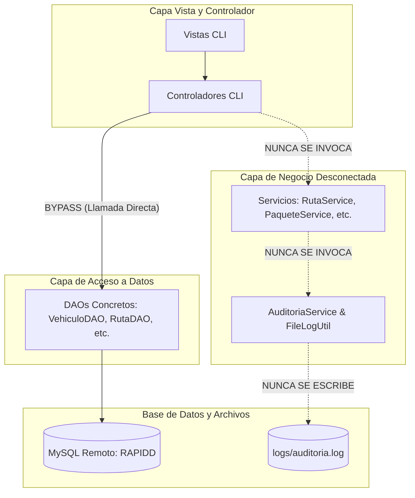
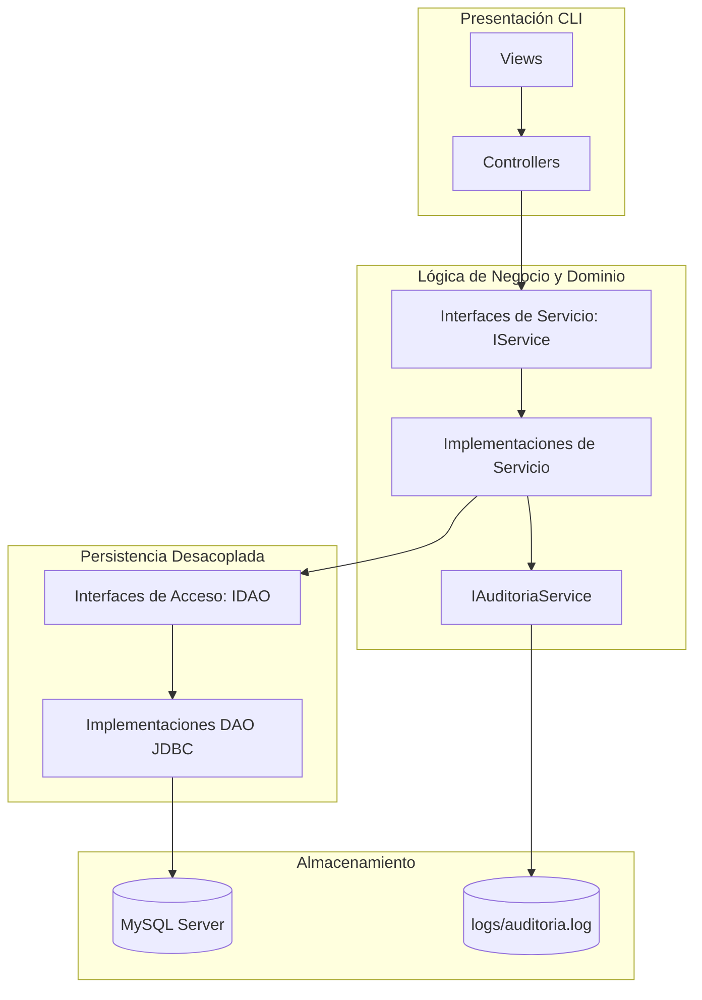

# Análisis Técnico: Los 5 Fallos Principales y Violaciones a Principios SOLID
**Proyecto:** RapidExpress - Sistema de Gestión de Flotas y Rutas  
**Fecha:** 2026-09-03  
**Auditor:** Desarrollador Senior Java & MySQL / Evaluador Técnico  

---

## Índice
1. [Introducción y Diagnóstico General](#1-introducción-y-diagnóstico-general)
2. [Los 5 Fallos Principales del Sistema](#2-los-5-fallos-principales-del-sistema)
   - [Fallo 1: Creación de Paquetes Rota por Envío de Clave Primaria Nula](#fallo-1-creación-de-paquetes-rota-por-envío-de-clave-primaria-nula)
   - [Fallo 2: Planificación de Rutas sin Asignación de Carga ni Control de Capacidad](#fallo-2-planificación-de-rutas-sin-asignación-de-carga-ni-control-de-capacidad)
   - [Fallo 3: Inicio de Ruta Incompleto (Inconsistencia de Estados)](#fallo-3-inicio-de-ruta-incompleto-inconsistencia-de-estados)
   - [Fallo 4: Desconexión Total del Sistema de Auditoría y Persistencia en Archivo Plano](#fallo-4-desconexión-total-del-sistema-de-auditoría-y-persistencia-en-archivo-plano)
   - [Fallo 5: Omisión de Reportes Operativos Críticos en la Capa de Presentación (CLI)](#fallo-5-omisión-de-reportes-operativos-críticos-en-la-capa-de-presentación-cli)
3. [Análisis Detallado de Principios SOLID](#3-análisis-detallado-de-principios-solid)
   - [S - Single Responsibility Principle (Principio de Responsabilidad Única)](#s---single-responsibility-principle-srp)
   - [O - Open/Closed Principle (Principio de Abierto/Cerrado)](#o---openclosed-principle-ocp)
   - [L - Liskov Substitution Principle (Principio de Sustitución de Liskov)](#l---liskov-substitution-principle-lsp)
   - [I - Interface Segregation Principle (Principio de Segregación de Interfaces)](#i---interface-segregation-principle-isp)
   - [D - Dependency Inversion Principle (Principio de Inversión de Dependencias)](#d---dependency-inversion-principle-dip)
4. [Diagrama Arquitectónico: Estado Actual vs. Estado Esperado](#4-diagrama-arquitectónico-estado-actual-vs-estado-esperado)
5. [Guía de Remediación Paso a Paso](#5-guía-de-remediación-paso-a-paso)

---

## 1. Introducción y Diagnóstico General

El sistema **RapidExpress** cuenta con una base de datos relacional robusta en MySQL, un conjunto de entidades modeladas con el patrón *Builder* y una estructura de paquetes organizada siguiendo convenciones de Maven.

Sin embargo, el sistema padece de un **defecto de integración arquitectónica fundamental**: **la capa de servicios (`com.RapidExpress.service.*`) está totalmente huérfana (código muerto en tiempo de ejecución)**. Los controladores de la consola (`com.RapidExpress.controller.*`) consumen directamente los objetos de acceso a datos (`com.RapidExpress.dao.*`), ignorando la capa donde residen las reglas de negocio, las validaciones de dominio, los cálculos de carga y el registro de auditoría.

A continuación se desglosan los 5 fallos operativos derivados de esta desconexión y las violaciones a los principios SOLID detectadas en el código.

---

## 2. Los 5 Fallos Principales del Sistema

### Fallo 1: Creación de Paquetes Rota por Envío de Clave Primaria Nula

#### Evidencia en Código
* **Vista:** `com.RapidExpress.view.PaqueteView.readNewPaqueteData()` (Línea 59):
```java
// PaqueteView retorna un Paquete con ID nulo
return new Paquete(null, desc, peso, dim, origen, destino,
        remNom, remCon, remDir, destNom, destCon, destDir, EstadoPaquete.EN_BODEGA);
```
* **Controlador:** `com.RapidExpress.controller.PaqueteController.crearPaquete()` (Líneas 38-40):
```java
Paquete paquete = PaqueteView.readNewPaqueteData();
if (paquete != null) {
    if (dao.create(paquete)) { // Invoca directamente al DAO pasando idSeguimiento = null
        ConsoleUtil.printSuccess("Paquete registrado exitosamente...");
```
* **DAO:** `com.RapidExpress.dao.PaqueteDAO.create()` (Línea 28):
```java
stmt.setString(1, paquete.getIdSeguimiento()); // Establece NULL en la columna NOT NULL
```

#### Impacto y Causa Raíz
1. La columna `id_seguimiento` de la tabla `paquete` está definida como `VARCHAR(36) NOT NULL PRIMARY KEY`.
2. Al ejecutar la opción **"1. Registrar paquete"** desde la consola, el DAO ejecuta el `PreparedStatement` con valor `null`, provocando una `SQLException` (`Column 'id_seguimiento' cannot be null`).
3. La lógica requerida para generar el identificador único (`PKG-UUID`) fue programada en `PaqueteService.registrarPaquete()`, pero al estar desacoplado el controlador del servicio, **ningún paquete nuevo puede ser registrado por el usuario en la aplicación**.

---

### Fallo 2: Planificación de Rutas sin Asignación de Carga ni Control de Capacidad

#### Evidencia en Código
* **Requisito Oficial:**
  > *"Permitir a un operador de logística la creación de una 'hoja de ruta' diaria, la cual consiste en asignar un conjunto de paquetes (En Bodega) a un vehículo y su conductor correspondiente. El sistema no debe permitir exceder la capacidad de carga del vehículo."*
* **Controlador Real:** `com.RapidExpress.controller.RutaController.crearRuta()` (Líneas 46-56):
```java
Ruta ruta = RutaView.readNewRutaData(); // Pide fecha, vehiculo_placa y conductor_id
if (ruta == null) return;
if (!vehiculoDAO.exists(ruta.getVehiculoPlaca())) { ... }
if (!conductorDAO.exists(ruta.getConductorId())) { ... }
if (dao.create(ruta)) { ... } // Guarda la cabecera SIN paquetes
```

#### Impacto y Causa Raíz
1. La consola nunca solicita al operador qué paquetes formarán parte de la ruta.
2. Como no se asocian paquetes, **jamás se calcula el peso total de carga ni se valida contra `vehiculo.getCapacidadMaxKg()`**.
3. La tabla intermedia `ruta_paquete` queda vacía para toda ruta creada desde la interfaz CLI.
4. Aunque `RutaService.crearHojaDeRuta()` contiene la validación y lanza `CapacidadExcedidaException`, el controlador ignora este servicio por completo.

---

### Fallo 3: Inicio de Ruta Incompleto (Inconsistencia de Estados)

#### Evidencia en Código
* **Requisito Oficial:**
  > *"Al iniciar una ruta, el estado del vehículo y del conductor debe cambiar a En Ruta, y el de los paquetes a En Tránsito."*
* **Controlador Real:** `com.RapidExpress.controller.RutaController.iniciarRuta()` (Líneas 109-113):
```java
dao.findById(id).ifPresentOrElse(ruta -> {
    if (dao.iniciarRuta(id)) { // Solo ejecuta: UPDATE ruta SET estado = 'En_Curso' WHERE id_ruta = ?
        ConsoleUtil.printSuccess("Ruta " + id + " iniciada.");
    }
```

#### Impacto y Causa Raíz
1. El vehículo involucrado permanece en estado `Disponible` (o el estado que tuviera antes), pudiendo ser asignado a otra ruta simultáneamente.
2. El conductor permanece en estado `Activo`.
3. Los paquetes permanecen en su estado anterior (`Asignado_Ruta` o `En_Bodega`) y nunca pasan a `En_Transito`.
4. Nuevamente, la orquestación multi-entidad estaba implementada en `RutaService.iniciarRuta()` pero nunca es llamada por el controlador.

---

### Fallo 4: Desconexión Total del Sistema de Auditoría y Persistencia en Archivo Plano

#### Evidencia en Código
* **Requisito Oficial:**
  > *"Mantener un registro de auditoría de todas las operaciones críticas que ocurren en el sistema (creación de paquetes, inicio y fin de una ruta, cambios de estado importantes). Esta información debe ser registrada en un archivo de texto centralizado."*
* **Implementación en Archivo:** `com.RapidExpress.util.FileLogUtil.appendAuditLog()` (Líneas 48-67).
* **Referencias:** Solo es invocado por `AuditoriaService.registrar()`:
```java
FileLogUtil.appendAuditLog(operacion, entidad, entidadId, usuario, detalles);
auditoriaDAO.create(auditoria);
```

#### Impacto y Causa Raíz
1. Ningún controlador (`VehiculoController`, `ConductorController`, `PaqueteController`, `RutaController`, `MantenimientoController`) tiene referencia ni a `AuditoriaService` ni a `FileLogUtil`.
2. Durante el ciclo de vida completo de ejecución de la consola, **no se escribe un solo byte en el archivo plano `logs/auditoria.log` ni se inserta registro alguno en la tabla `auditoria` de MySQL**.

---

### Fallo 5: Omisión de Reportes Operativos Críticos en la Capa de Presentación (CLI)

#### Evidencia en Código
* **Requisito Oficial:**
  > *"Generar reportes operativos. Por ejemplo, un listado de todas las entregas realizadas por un conductor en un rango de fechas específico o un informe sobre el historial de rutas de un vehículo."*
* **Servicio Implementado:** `com.RapidExpress.service.ReporteService` tiene métodos funcionales:
  - `generarReporteEntregasPorConductor(conductorId, inicio, fin)`
  - `generarHistorialRutasVehiculo(placa)`
  - `generarResumenCostosMantenimiento()`
* **Vista Real:** `com.RapidExpress.view.ReporteView.showMenu()`:
```java
System.out.println("1. Vehiculos (todos)");
System.out.println("2. Conductores (todos)");
System.out.println("3. Paquetes en bodega");
System.out.println("4. Rutas en curso");
System.out.println("5. Mantenimientos por vehiculo");
System.out.println("6. Ultimas auditorias");
```

#### Impacto y Causa Raíz
1. Los reportes operativos avanzados requeridos no tienen opción en el menú de la consola.
2. `ReporteController` solo hace lecturas masivas tipo `findAll()` y `countByEstado()` directamente contra los DAOs.
3. El usuario operador no dispone de filtrado por rango de fechas para conductores ni historial consolidado por vehículo.

---

## 3. Análisis Detallado de Principios SOLID

### S - Single Responsibility Principle (SRP)
> *"Una clase debe tener una y solo una razón para cambiar."*

#### Violaciones Identificadas:
1. **Controladores con responsabilidades mezcladas:**
   - Clases como `ConductorController`, `VehiculoController` y `RutaController` son responsables simultáneamente de la coordinación del flujo de usuario, validaciones de existencia de registros foráneos, mutación directa del estado de la base de datos y control de presentación de errores.
2. **DAOs con control de salida por consola:**
   - Métodos como `PaqueteDAO.create()` y `VehiculoDAO.create()` capturan `SQLException` e imprimen directamente mensajes formateados en `System.err`. La persistencia y el formateo de errores para la UI son dos responsabilidades distintas.
3. **Entidades con lógica de validación de negocio rígida:**
   - La entidad `Vehiculo` valida en su setter `anioFabricacion` (1990 - 2030) lanzando `IllegalArgumentException`, duplicando la misma regla existente en `DataValidator` y en la base de datos.

---

### O - Open/Closed Principle (OCP)
> *"Las entidades de software deben estar abiertas a la extensión, pero cerradas a la modificación."*

#### Violaciones Identificadas:
1. **Control de Flujo por Sentencias `switch` y métodos monolíticos:**
   - En `RutaService.actualizarEntregaPaquete()`, el comportamiento ante diferentes estados de entrega (`ENTREGADO`, `DEVUELTO`, `NO_ENTREGADO`) se maneja con un `switch` procedural que muta múltiples DAOs directamente. Agregar un nuevo estado operacional (como `REAGENDADO` o `EXTRAVIADO`) obliga a modificar este método central.
2. **Generación de Reportes mediante Concatenación Directa:**
   - En `ReporteService`, cada reporte nuevo requiere escribir un nuevo método que concatena manualmente líneas con `StringBuilder`. No existe un mecanismo extensible de exportadores o formateadores (ej. interfaz `ReportFormatter` con implementaciones `ConsoleFormatter`, `PlainTextFileFormatter`, `CsvFormatter`).

---

### L - Liskov Substitution Principle (LSP)
> *"Los subtipos deben ser sustituibles por sus tipos base sin alterar el comportamiento correcto del programa."*

#### Violaciones Identificadas:
1. **Jerarquía de Excepciones Incoherente en Captura y Lanzamiento:**
   - Toda la jerarquía de excepciones del paquete `com.RapidExpress.exception.*` (`DatoRequeridoException`, `FormatoInvalidoException`, `RangoInvalidoException`) hereda de `ValidacionException` (que a su vez hereda de `RapidExpressException` -> `Exception` comprobada).
   - Sin embargo, las entidades (`Vehiculo`, `Conductor`) en sus constructores y setters lanzan `IllegalArgumentException` (excepción no comprobada de la JVM).
   - Los DAOs no lanzan `RapidExpressException` ni sustitutos de persistencia; atrapan `SQLException` y devuelven `false`. Esta asimetría rompe el contrato de sustitución en la captura de errores en capas superiores.

---

### I - Interface Segregation Principle (ISP)
> *"Los clientes no deben verse obligados a depender de interfaces que no utilizan."*

#### Violaciones Identificadas:
1. **Ausencia Absoluta de Interfaces en Repositorios y Servicios:**
   - No existe una interfaz `GenericDAO<T, ID>` ni interfaces específicas (`VehiculoDAOInterface`, `ConductorDAOInterface`).
   - Los controladores dependen directamente de clases concretas (`VehiculoDAO`, `ConductorDAO`, `RutaDAO`) cargadas con decenas de métodos que el controlador específico no requiere (por ejemplo, `RutaController` utiliza métodos aislados de `VehiculoDAO` pero depende de toda la clase concreta).
2. **Falta de Segregación en Métodos de Lectura y Escritura:**
   - Clases como `VehiculoDAO` agrupan consultas de reportería (`count()`, `countByEstado()`), consultas de negocio (`findDisponibles()`, `findEnRuta()`) y operaciones de mutación (`create()`, `update()`, `delete()`) en un único contrato monolítico.

---

### D - Dependency Inversion Principle (DIP)
> *"Los módulos de alto nivel no deben depender de módulos de bajo nivel. Ambos deben depender de abstracciones. Las abstracciones no deben depender de los detalles; los detalles deben depender de las abstracciones."*

#### Violaciones Identificadas:
1. **Instanciación Directa (*Hardcoded Dependencies*):**
   - Todos los controladores instancian sus dependencias directamente con el operador `new`:
     ```java
     public class RutaController {
         private final RutaDAO dao = new RutaDAO();
         private final VehiculoDAO vehiculoDAO = new VehiculoDAO();
         private final ConductorDAO conductorDAO = new ConductorDAO();
     ```
   - Esto acopla la capa de presentación directamente a las implementaciones concretas de JDBC, impidiendo la inyección de dependencias, la sustitución por mocks en pruebas unitarias y el desacoplamiento de capas.
2. **Servicios Acoplados a DAOs Concretos:**
   - Aunque los servicios ofrecen constructores sobrecargados, por defecto instancian los DAOs concretos (`new RutaDAO()`, `new VehiculoDAO()`), dependiendo directamente de las clases de bajo nivel en lugar de abstracciones (`IRutaDAO`, `IVehiculoDAO`).

---

## 4. Diagrama Arquitectónico: Estado Actual vs. Estado Esperado

### Arquitectura Actual (Implementada en el Código)


### Arquitectura Correcta (Patrón MVC / Multicapa con SOLID)


---

## 5. Guía de Remediación Paso a Paso

Para corregir los 5 fallos principales y alinear el proyecto a los estándares exigidos, se deben realizar las siguientes intervenciones:

### Paso 1: Inyectar Servicios en los Controladores
Modificar los controladores para que dependan de la capa `Service` en lugar de los `DAO`:
```java
// Ejemplo en PaqueteController:
public class PaqueteController {
    private final PaqueteService paqueteService;

    public PaqueteController() {
        this.paqueteService = new PaqueteService();
    }
    
    private void crearPaquete(int opt) {
        Paquete paquete = PaqueteView.readNewPaqueteData();
        if (paquete != null) {
            try {
                // PaqueteService genera el ID único y audita la operación
                String id = paqueteService.registrarPaquete(paquete, "OPERADOR_CLI");
                ConsoleUtil.printSuccess("Paquete registrado con éxito. ID: " + id);
            } catch (RapidExpressException e) {
                ConsoleUtil.printError(e.getMessage());
            }
        }
    }
}
```

### Paso 2: Completar la Creación e Inicio de Rutas en la Vista y Controlador
1. En `RutaView`, implementar el método `readNewRutaDataWithPackages()` que liste los paquetes en bodega (`paqueteService.listarEnBodega()`) y permita al operador seleccionar los IDs a cargar.
2. En `RutaController.crearRuta()`, invocar `rutaService.crearHojaDeRuta(fecha, placa, conductorId, paquetesIds, usuario)`.
3. En `RutaController.iniciarRuta()`, llamar a `rutaService.iniciarRuta(idRuta, usuario)` para que el vehículo, conductor y paquetes transicionen de forma consistente.

### Paso 3: Exponer los Reportes Operativos en la CLI
En `ReporteView` y `ReporteController`, agregar las opciones:
- Reporte de entregas por conductor solicitando identificación y rango de fechas (`LocalDate.parse`).
- Historial de rutas de vehículo solicitando placa.
- Invocar los métodos ya desarrollados en `ReporteService` e imprimirlos o exportarlos con `FileLogUtil`.

### Paso 4: Introducir Abstracciones (Interfaces)
Crear interfaces para la capa de acceso a datos (`IVehiculoDAO`, `IConductorDAO`, `IPaqueteDAO`, `IRutaDAO`) y para la capa de servicios, desacoplando los componentes y cumpliendo con **DIP** e **ISP**.

### Paso 5: Transaccionalidad Atómica (ACID) en Operaciones Compuestas
En `RutaDAO` o mediante una unidad de trabajo (*Unit of Work*), gestionar transacciones explícitas con `conn.setAutoCommit(false)`, ejecutando el commit o rollback ante fallos en la actualización de paquetes o rutas.
