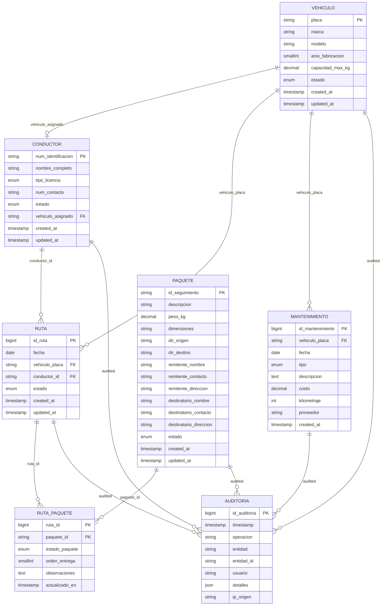

# RapidExpress - Entity Relationship Diagram (ERD)

## Mermaid Diagram



## Text-Based ERD (Alternative)

```
┌─────────────────┐       ┌──────────────────┐       ┌─────────────┐
│    VEHICULO     │       │    CONDUCTOR     │       │    RUTA     │
├─────────────────┤       ├──────────────────┤       ├─────────────┤
│ PK placa        │◄─────►│ PK num_identif.  │       │ PK id_ruta  │
│ marca           │ 1:1   │ nombre_completo  │       │ fecha       │
│ modelo          │       │ tipo_licencia    │       │ FK vehiculo │
│ anio_fabricacion│       │ num_contacto     │       │ FK conductor│
│ capacidad_max_kg│       │ estado           │       │ estado      │
│ estado          │       │ FK vehiculo_asig.│       │ created_at  │
│ created_at      │       │ created_at       │       │ updated_at  │
│ updated_at      │       │ updated_at       │       └──────┬──────┘
└────────┬────────┘       └──────────────────┘              │
         │                                                  │
         │ 1:N                                              │ 1:N
         ▼                                                  ▼
┌─────────────────┐                            ┌─────────────────────┐
│  MANTENIMIENTO  │                            │   RUTA_PAQUETE      │
├─────────────────┤                            ├─────────────────────┤
│ PK id_mantenim. │                            │ PK ruta_id (FK)     │
│ FK vehiculo     │                            │ PK paquete_id (FK)  │
│ fecha           │                            │ estado_paquete      │
│ tipo            │                            │ orden_entrega       │
│ descripcion     │                            │ observaciones       │
│ costo           │                            │ actualizado_en      │
│ kilometraje     │                            └──────────┬──────────┘
│ proveedor       │                                       │
│ created_at      │                                       │ N:M
└─────────────────┘                                       ▼
                                                          ┌─────────────┐
                                                          │   PAQUETE   │
                                                          ├─────────────┤
                                                          │ PK id_seguim│
                                                          │ descripcion │
                                                          │ peso_kg     │
                                                          │ dimensiones │
                                                          │ dir_origen  │
                                                          │ dir_destino │
                                                          │ remitente_* │
                                                          │ destinatario*│
                                                          │ estado      │
                                                          │ created_at  │
                                                          │ updated_at  │
                                                          └─────────────┘

┌─────────────────────────────────────────────────────────────────────┐
│                        AUDITORIA (Centralized Log)                  │
├─────────────────────────────────────────────────────────────────────┤
│ PK id_auditoria  │ timestamp │ operacion │ entidad │ entidad_id    │
│ usuario          │ detalles(JSON)    │ ip_origen                   │
└─────────────────────────────────────────────────────────────────────┘
```

## Relationship Summary

| Relationship | Type | Description |
|-------------|------|-------------|
| `vehiculo` → `conductor` | 1:1 (optional) | One vehicle assigned to at most one driver; one driver drives at most one vehicle |
| `vehiculo` → `ruta` | 1:N | A vehicle can be used in many routes over time |
| `conductor` → `ruta` | 1:N | A driver can drive many routes over time |
| `ruta` → `ruta_paquete` | 1:N | A route contains many package assignments |
| `paquete` → `ruta_paquete` | 1:N | A package can be assigned to multiple routes (e.g., returned & re-shipped) |
| `vehiculo` → `mantenimiento` | 1:N | A vehicle has many maintenance records |
| All entities → `auditoria` | 1:N | Every critical operation on any entity creates an audit entry |

## Normalization Level

- **1NF**: ✅ All attributes atomic, no repeating groups
- **2NF**: ✅ No partial dependencies (all non-key attributes depend on full PK)
- **3NF**: ✅ No transitive dependencies
- **BCNF**: ✅ Every determinant is a candidate key
- **4NF**: ✅ No multi-valued dependencies (resolved via `ruta_paquete` junction)

## Key Design Decisions

1. **Natural PKs** for `vehiculo.placa` and `conductor.num_identificacion` — business identifiers
2. **Surrogate PK** (`BIGINT AUTO_INCREMENT`) for `ruta`, `mantenimiento`, `auditoria` — performance
3. **UUID** (`VARCHAR(36)`) for `paquete.id_seguimiento` — globally unique tracking IDs
4. **Junction table `ruta_paquete`** — resolves many-to-many with per-package route status
5. **ENUM columns** — enforce valid states at DB level (cheaper than CHECK constraints)
6. **Audit table** — append-only, denormalized for write performance; JSON for flexible details
7. **Views** — `v_ruta_detalle` and `v_vehiculo_estado` for common reporting queries