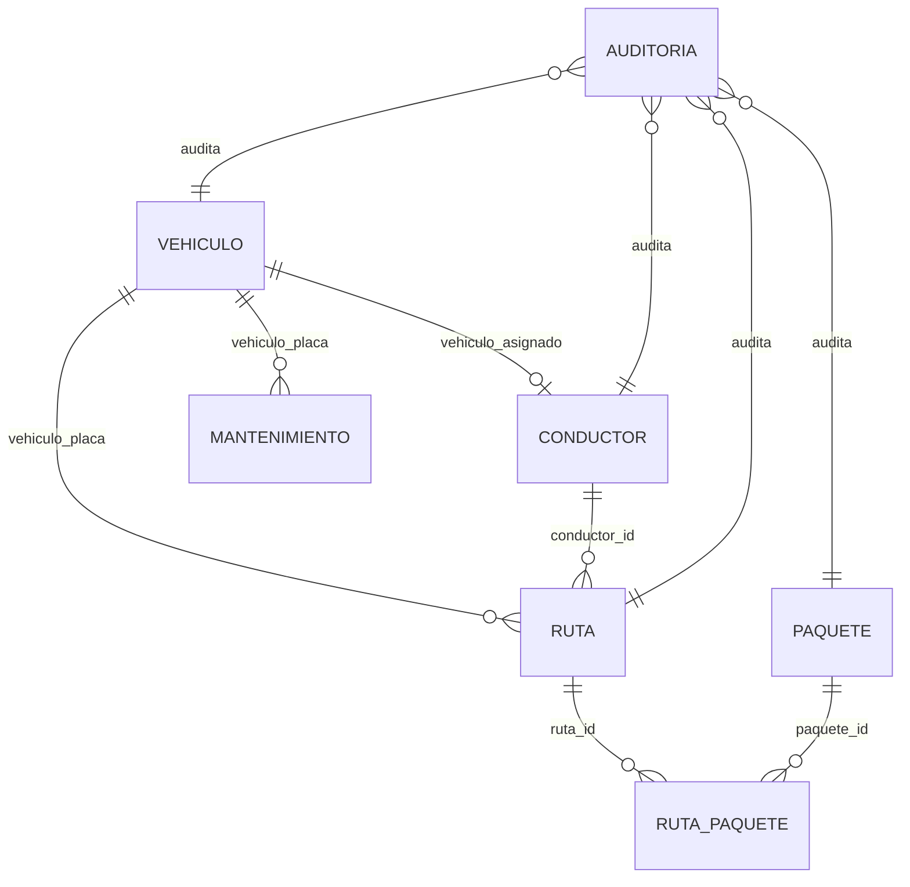

# Guía Técnica de Base de Datos - RapidExpress (`RAPIDD`)

Este documento constituye la guía oficial y análisis de la base de datos relacional del sistema **RapidExpress**, alojada en el servidor MySQL remoto. Incluye el inventario y análisis exhaustivo de registros por tabla, el esquema de relaciones, la configuración de la capa de conexión en Java y el flujo de gestión de datos desde la arquitectura MVC hacia la persistencia.

---

## 1. Parámetros de Conexión al Servidor Remoto

| Parámetro | Valor Configurado | Variable de Entorno | Propiedad JVM |
| :--- | :--- | :--- | :--- |
| **Host / IP** | `2.24.207.152` | `DB_HOST` | `-Ddb.host` |
| **Puerto** | `3306` | `DB_PORT` | `-Ddb.port` |
| **Base de Datos** | `RAPIDD` | `DB_NAME` | `-Ddb.name` |
| **Usuario** | `root` | `DB_USER` | `-Ddb.user` |
| **Contraseña** | `Th4n4tos_?*` | `DB_PASSWORD` | `-Ddb.password` |
| **Charset** | `utf8mb4` | - | `characterEncoding=UTF-8` |
| **Timezone** | `UTC` | - | `serverTimezone=UTC` |

> [!NOTE]
> La base de datos activa del proyecto en el servidor es **`RAPIDD`**, la cual implementa el modelo canónico de 7 tablas relacionales y 2 vistas de reportería.

---

## 2. Análisis Detallado de Registros en las Siete (7) Tablas

A continuación se detalla el análisis de datos reales persistidos en cada una de las tablas del esquema:

### 2.1. Tabla: `vehiculo` (25 registros)
- **Propósito**: Almacena el parque automotor disponible para operaciones logísticas.
- **Clave Primaria**: `placa` (`VARCHAR(10)`).
- **Restricciones**: `chk_vehiculo_anio` (1990 - 2030), `chk_vehiculo_capacidad` (> 0 kg).
- **Métricas y Distribución**:
  - **Capacidad de carga**: Rango entre `5,000.00 kg` (camiones ligeros Chevrolet NPR) y `22,000.00 kg` (tractocamiones Kenworth T800 / International WorkStar). Promedio: `14,200.00 kg`.
  - **Años de fabricación**: De 2018 a 2023.
  - **Distribución de Estados**:
    - `Disponible`: 21 vehículos (84%)
    - `En_Ruta`: 2 vehículos (`ABC-125`, `ABC-132`) (8%)
    - `En_Mantenimiento`: 2 vehículos (`ABC-140`, `ABC-145`) (8%)
- **Muestra de Datos Representativa**:
  | Placa | Marca | Modelo | Año | Capacidad (kg) | Estado |
  | :--- | :--- | :--- | :--- | :--- | :--- |
  | `ABC-123` | Chevrolet | NPR 700 | 2020 | 5000.00 | `Disponible` |
  | `ABC-125` | Ford | F-650 | 2019 | 7000.00 | `En_Ruta` |
  | `ABC-140` | Hino | 500 Series | 2018 | 8500.00 | `En_Mantenimiento` |

---

### 2.2. Tabla: `conductor` (25 registros)
- **Propósito**: Control del personal calificado asignado a los vehículos y rutas.
- **Clave Primaria**: `num_identificacion` (`VARCHAR(20)`).
- **Clave Foránea / Única**: `vehiculo_asignado` $\rightarrow$ `vehiculo(placa)` con restricción `UNIQUE` (un conductor no puede tener más de un vehículo asignado y viceversa).
- **Métricas y Distribución**:
  - **Tipos de Licencia**:
    - Categoría `C`: 13 conductores (52%)
    - Categoría `E`: 11 conductores (44%)
    - Categoría `D`: 1 conductor (4%)
  - **Distribución de Estados**:
    - `Activo`: 21 conductores (84%)
    - `En_Ruta`: 2 conductores (`1000000003`, `1000000010`) (8%)
    - `De_Vacaciones`: 1 conductor (`1000000021`) (4%)
    - `Inactivo`: 1 conductor (`1000000025`) (4%)
- **Muestra de Datos Representativa**:
  | Identificación | Nombre Completo | Licencia | Contacto | Estado | Vehículo Asignado |
  | :--- | :--- | :--- | :--- | :--- | :--- |
  | `1000000001` | Carlos Andres Rodriguez | C | 3001112233 | `Activo` | `ABC-123` |
  | `1000000003` | Juan Carlos Martinez | E | 3001112255 | `En_Ruta` | `ABC-125` |
  | `1000000021` | Jorge Eliecer Gaitan | C | 3001112231 | `De_Vacaciones` | *NULL* |

---

### 2.3. Tabla: `paquete` (60 registros)
- **Propósito**: Registro de envíos individuales que conforman la carga logística.
- **Clave Primaria**: `id_seguimiento` (`VARCHAR(36)`), formato estandarizado `PKG-YYYYMMDD-XXX`.
- **Restricciones**: `chk_paquete_peso` (> 0 kg).
- **Métricas y Distribución**:
  - **Peso de Paquetes**: Mínimo `1.20 kg`, Máximo `200.00 kg`, Promedio `22.61 kg`.
  - **Distribución de Estados**:
    - `Asignado_Ruta`: 55 paquetes (91.7%)
    - `Entregado`: 3 paquetes (5.0%)
    - `En_Transito`: 2 paquetes (3.3%)
- **Muestra de Datos Representativa**:
  | ID Seguimiento | Descripción | Peso (kg) | Dimensiones | Remitente | Destinatario | Estado |
  | :--- | :--- | :--- | :--- | :--- | :--- | :--- |
  | `PKG-20240115-001` | Documentos legales | 2.50 | 30x20x5 | LegalTech SAS | Abogados Asociados | `Entregado` |
  | `PKG-20240115-003` | Electrónicos | 8.75 | 40x30x20 | TechImport Ltda | ElectroBarranquilla | `En_Transito` |
  | `PKG-20240116-006` | Insumos médicos | 18.50 | 60x40x40 | Salud Total IPS | Clinica Central | `Asignado_Ruta` |

---

### 2.4. Tabla: `ruta` (20 registros)
- **Propósito**: Planificación y ejecución de despachos diarios de transporte.
- **Clave Primaria**: `id_ruta` (`BIGINT UNSIGNED AUTO_INCREMENT`).
- **Claves Foráneas**:
  - `vehiculo_placa` $\rightarrow$ `vehiculo(placa)`
  - `conductor_id` $\rightarrow$ `conductor(num_identificacion)`
- **Distribución de Estados**:
  - `Planificada`: 18 rutas (90%)
  - `En_Curso`: 2 rutas (Rutas #1 y #2) (10%)
- **Muestra de Datos Representativa**:
  | ID Ruta | Fecha | Vehículo | Conductor | Estado |
  | :--- | :--- | :--- | :--- | :--- |
  | `1` | `2024-01-15` | `ABC-125` | `1000000003` (Juan Martinez) | `En_Curso` |
  | `2` | `2024-01-15` | `ABC-132` | `1000000010` (Diana Morales) | `Planificada` |
  | `3` | `2024-01-16` | `ABC-136` | `1000000014` (Gabriel Garcia) | `Planificada` |

---

### 2.5. Tabla: `ruta_paquete` (60 registros)
- **Propósito**: Tabla asociativa (N:M) que vincula los paquetes a una ruta con orden de entrega secuencial.
- **Clave Primaria Compuesta**: `(ruta_id, paquete_id)`.
- **Claves Foráneas**:
  - `ruta_id` $\rightarrow$ `ruta(id_ruta)` (`ON DELETE CASCADE`)
  - `paquete_id` $\rightarrow$ `paquete(id_seguimiento)` (`ON DELETE RESTRICT`)
- **Distribución de Estados en Ruta**:
  - `Asignado`: 55 registros (91.7%)
  - `Entregado`: 3 registros (5.0%)
  - `En_Transito`: 2 registros (3.3%)
- **Muestra de Datos Representativa**:
  | ID Ruta | ID Paquete | Orden Entrega | Estado en Ruta | Observaciones |
  | :--- | :--- | :--- | :--- | :--- |
  | `1` | `PKG-20240115-001` | 1 | `Entregado` | *NULL* |
  | `1` | `PKG-20240115-002` | 2 | `Entregado` | *NULL* |
  | `1` | `PKG-20240115-003` | 3 | `En_Transito` | *NULL* |

---

### 2.6. Tabla: `mantenimiento` (25 registros)
- **Propósito**: Historial de intervenciones mecánicas, revisiones y costos por vehículo.
- **Clave Primaria**: `id_mantenimiento` (`BIGINT UNSIGNED AUTO_INCREMENT`).
- **Clave Foránea**: `vehiculo_placa` $\rightarrow$ `vehiculo(placa)` (`ON DELETE CASCADE`).
- **Métricas y Distribución**:
  - **Tipos de Mantenimiento**:
    - `Preventivo`: 18 registros (72%)
    - `Correctivo`: 5 registros (20%)
    - `Inspeccion`: 2 registros (8%)
  - **Costos**: Oscilan entre `$120,000.00` y `$3,500,000.00 COP`.
- **Muestra de Datos Representativa**:
  | ID | Vehículo | Fecha | Tipo | Costo | Descripción | Proveedor |
  | :--- | :--- | :--- | :--- | :--- | :--- | :--- |
  | `1` | `ABC-123` | `2023-06-15` | `Preventivo` | 450000.00 | Cambio de aceite y filtros | Chevrolet Servicio Autorizado |
  | `2` | `ABC-123` | `2023-12-10` | `Preventivo` | 680000.00 | Revisión frenos y suspensión | Chevrolet Servicio Autorizado |
  | `7` | `ABC-127` | `2023-09-15` | `Correctivo` | 1850000.00 | Reparación sistema de inyección | Kenworth de la Montaña |

---

### 2.7. Tabla: `auditoria` (20 registros)
- **Propósito**: Bitácora inmutable de transacciones críticas del sistema (seguridad y trazabilidad).
- **Clave Primaria**: `id_auditoria` (`BIGINT UNSIGNED AUTO_INCREMENT`).
- **Campos Clave**: `timestamp`, `operacion`, `entidad`, `entidad_id`, `usuario`, `detalles` (`JSON`), `ip_origen`.
- **Distribución de Operaciones Auditadas**:
  - `STATE_CHANGE_PAQUETE`: 5 registros
  - `CREATE_RUTA`: 3 registros
  - `ASSIGN_PACKAGES`: 3 registros
  - `DELIVER_PAQUETE`: 3 registros
  - `START_RUTA`: 2 registros
  - `STATE_CHANGE_VEHICULO`: 2 registros
  - `STATE_CHANGE_CONDUCTOR`: 2 registros
- **Muestra de Registros**:
  | ID | Operación | Entidad | Entidad ID | Usuario | Detalles (JSON) |
  | :--- | :--- | :--- | :--- | :--- | :--- |
  | `1` | `CREATE_RUTA` | `ruta` | `1` | `operador1` | `{"fecha": "2024-01-15", "vehiculo": "ABC-125", "conductor": "1000000003"}` |
  | `3` | `START_RUTA` | `ruta` | `1` | `operador1` | `{"new_state": "En_Curso", "old_state": "Planificada"}` |
  | `4` | `DELIVER_PAQUETE`| `paquete` | `PKG-20240115-001` | `conductor1`| `{"ruta_id": 1, "status": "Entregado"}` |

---

## 3. Diagrama de Relaciones de la Base de Datos



---

## 4. Configuración de la Conexión en Java (JDBC)

El proyecto utiliza el driver oficial **`com.mysql.cj.jdbc.Driver`** integrado mediante Maven (`pom.xml`):

```xml
<dependency>
    <groupId>com.mysql</groupId>
    <artifactId>mysql-connector-j</artifactId>
    <version>8.3.0</version>
</dependency>
```

### Clase de Conexión: `DatabaseConnection.java`
Ubicación: `src/main/java/com/RapidExpress/config/DatabaseConnection.java`

La clase implementa un patrón seguro de lectura de variables con fallback automático a los valores predeterminados:

```java
// URL JDBC parametrizada
String url = "jdbc:mysql://2.24.207.152:3306/RAPIDD?useSSL=false&allowPublicKeyRetrieval=true&serverTimezone=UTC&characterEncoding=UTF-8";

// Obtención de conexión
Connection conn = DriverManager.getConnection(url, "root", "Th4n4tos_?*");
```

### Sobrescritura de Parámetros (Variables de Entorno)
Para despliegue o pruebas locales sin modificar código, el sistema permite definir variables de entorno:
```bash
set DB_HOST=2.24.207.152
set DB_PORT=3306
set DB_NAME=RAPIDD
set DB_USER=root
set DB_PASSWORD=Th4n4tos_?*
```

---

## 5. Gestión y Envío de Datos a la DB (Arquitectura MVC)

El flujo de información para registrar y persistir datos opera de forma desacoplada:

```
[Usuario CLI]
      │ (Entrada por consola)
      ▼
[View: p.ej. VehiculoView / PaqueteView]
      │ (Valida formato básico)
      ▼
[Controller: p.ej. VehiculoController]
      │ (Invoca reglas de negocio)
      ▼
[Service: p.ej. VehiculoService]
      │ (Verifica unicidad, estados y capacidades)
      ▼
[DAO: p.ej. VehiculoDAO]
      │ (PreparedStatement + Transacciones ACID)
      ▼
[DatabaseConnection] ──► [MySQL Server Remoto: RAPIDD]
```

### Ejemplo de Envío de Datos con `PreparedStatement` (DAO)
```java
String sql = "INSERT INTO vehiculo (placa, marca, modelo, anio_fabricacion, capacidad_max_kg, estado) " +
             "VALUES (?, ?, ?, ?, ?, ?)";

try (Connection conn = DatabaseConnection.getConnection();
     PreparedStatement stmt = conn.prepareStatement(sql)) {

    stmt.setString(1, vehiculo.getPlaca());
    stmt.setString(2, vehiculo.getMarca());
    stmt.setString(3, vehiculo.getModelo());
    stmt.setInt(4, vehiculo.getAnioFabricacion());
    stmt.setBigDecimal(5, vehiculo.getCapacidadMaxKg());
    stmt.setString(6, vehiculo.getEstado().getDescripcion());

    stmt.executeUpdate();
}
```

### Reglas Clave al Gestionar Datos:
1. **Unicidad de Placa y Conductor**: Antes de asignar un conductor a un vehículo, verificar que el vehículo esté en estado `Disponible` y que el conductor no posea otro vehículo (`uk_conductor_vehiculo`).
2. **Capacidad de Carga en Rutas**: Al asociar paquetes a una ruta mediante `RutaService`, la suma de `peso_kg` de los paquetes no debe exceder `capacidad_max_kg` del vehículo asignado.
3. **Auditoría Automática**: Toda inserción, actualización o cambio de estado invoca en segundo plano `AuditoriaDAO` y `FileLogUtil` para registrar la operación en base de datos y en el archivo local `logs/audit.log`.
